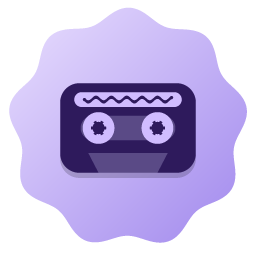
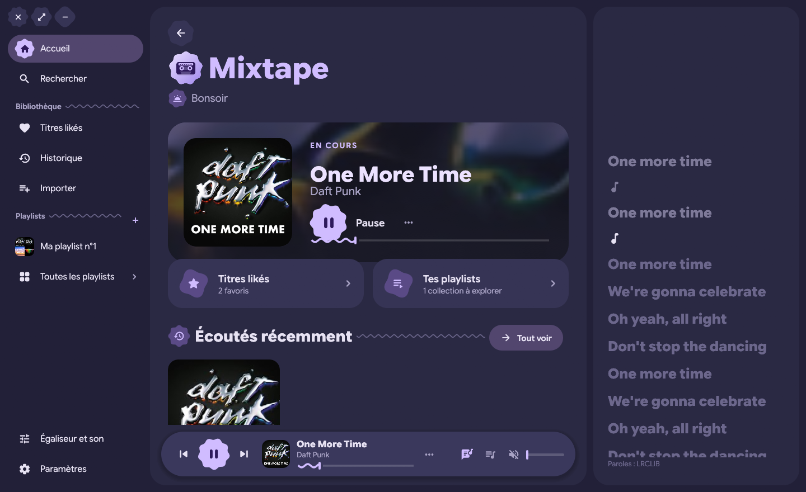
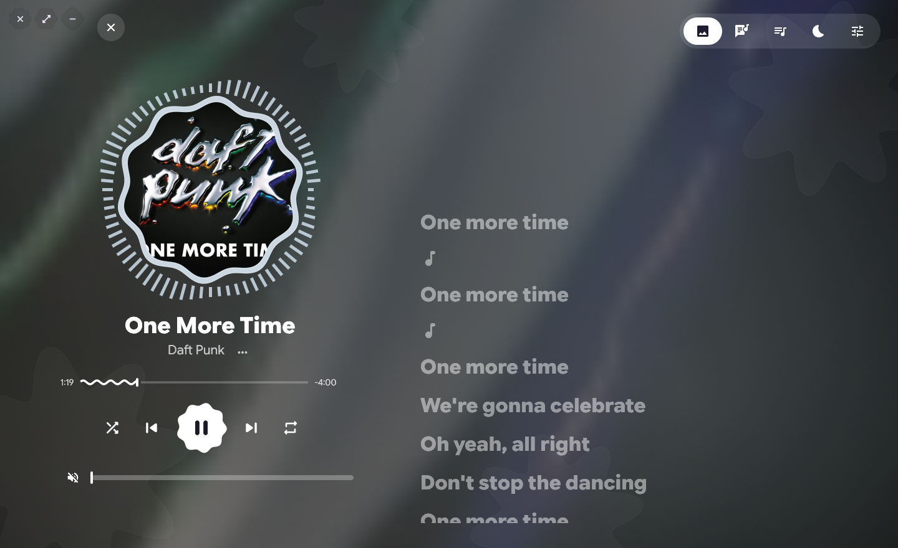
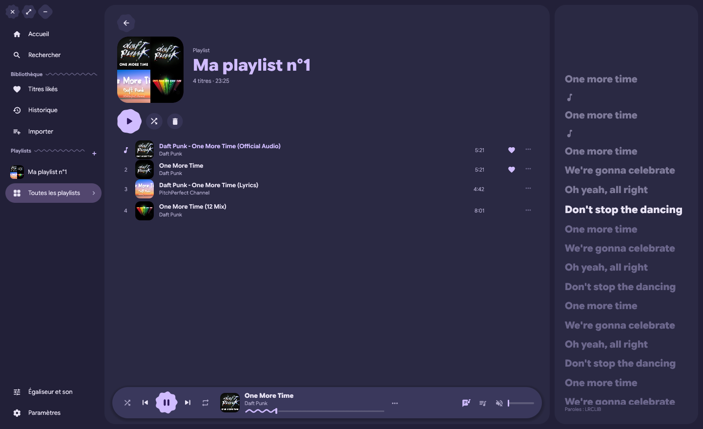
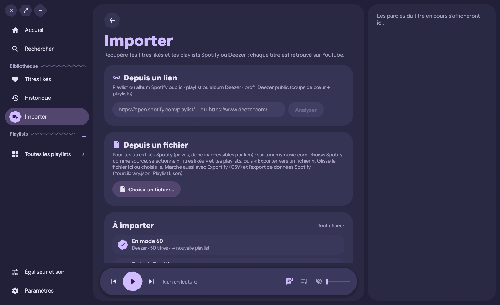

  

<h1 align="center">Mixtape</h1>

  Un lecteur de musique léger pour Windows : recherche YouTube, paroles synchronisées, titres likés et playlists — sans compte Spotify. 
  <em>A lightweight Windows music player: YouTube search, synced lyrics, liked songs and playlists — no Spotify account needed.</em>

  
  
  
  

## Fonctionnalités

- **Recherche YouTube** (ou URL de playlist YouTube collée telle quelle), lecture audio seule via mpv.
- **Bibliothèque locale** : titres likés, playlists, historique, file d'attente, « lire ensuite ».
- **Vue immersive** : pochette, fond tiré de ses couleurs, **paroles synchronisées** (LRCLIB), file, minuterie de veille.
- **Égaliseur 6 bandes** avec préréglages, normalisation du volume, **choix de la sortie audio**.
- **Import Spotify et Deezer** : playlists par lien, coups de cœur d'un profil Deezer public, titres likés Spotify via un fichier exporté (Tune My Music, Exportify, données Spotify). Chaque titre est retrouvé sur YouTube.
- Aléatoire, répétition, **session restaurée en pause** au démarrage.
- **Intégration Windows** : titre, artiste et pochette dans le panneau média de Windows, l'écran de verrouillage et les applis qui lisent les sessions média ; touches multimédia et boutons du casque.
- Japonais, coréen, chinois… affichés avec les polices de Windows, chargées à la demande.
- **Léger** : interface native (Rust + egui, rendu OpenGL), ~120 Mo de RAM + ~50 Mo pour mpv, ~0 % de CPU en pause.

Design inspiré de [Swiftify](https://github.com/swiftify-org/swiftify) (Material 3 Expressive) — redessiné ici, sans reprise de code.

## Installation

1. Télécharge le zip de la [dernière release](../../releases/latest) et décompresse-le.
2. Lance `Mixtape.exe` (le dossier `bin` avec `mpv.exe` et `yt-dlp.exe` doit rester à côté).
3. Si YouTube répond « Sign in to confirm you're not a bot », va dans **Paramètres → Accès à YouTube** et choisis le navigateur où tu es connecté à YouTube (Firefox est le plus fiable), puis **Tester**.

Tes données (likes, playlists, réglages) sont dans `%APPDATA%\Mixtape\library.json`.

Mettre à jour yt-dlp de temps en temps : `bin\yt-dlp.exe -U`.

## Compiler

- Rust ≥ 1.95 (`rustup update`), Windows 10/11 + outils MSVC.
- `cargo build --release`
- Place `mpv.exe` ([builds shinchiro](https://github.com/shinchiro/mpv-winbuild-cmake/releases)) et `yt-dlp.exe` ([releases](https://github.com/yt-dlp/yt-dlp/releases)) dans un dossier `bin` à côté de l'exécutable ou dans un dossier parent.

Tests sans souris : `mixtape.exe --autotest "<recherche>" <dossier>` (parcours de lecture avec captures), `"@tour <recherche>"` (toutes les vues), `"@import <lien>|<fichier>"`, `@restore`, `@settings`, `"@mesure <recherche>"`. Bibliothèque de test isolée, volume à 0.

## Comment ça marche

| Brique | Rôle |
|---|---|
| `src/mpv.rs` | mpv en arrière-plan (`--idle`, sans fenêtre), piloté par son IPC JSON sur tube nommé ; mpv résout les liens YouTube via yt-dlp |
| `src/search.rs` | recherche `ytsearch` de yt-dlp |
| `src/import.rs` | lecture des sources Spotify/Deezer/fichiers et correspondance YouTube (recherches groupées, score titre/artiste/durée) |
| `src/lyrics.rs` | paroles LRCLIB, titres nettoyés |
| `src/views.rs` | toute l'interface (formes « cookie », vagues, fond liquide dessinés à la main) |
| `icons/gen_logo.py` | génère le logo et l'icône |

## Avertissement

Mixtape lit des contenus publics de YouTube via yt-dlp, pour un usage personnel. L'usage de yt-dlp peut être contraire aux conditions d'utilisation de YouTube. Mixtape n'est affilié ni à YouTube, ni à Spotify, ni à Deezer.

## English

Mixtape is a native (Rust/egui) Windows music player that searches and streams audio from YouTube through mpv and yt-dlp. It keeps a local library (likes, playlists, history), shows synced lyrics from LRCLIB, has a 6-band equalizer, sleep timer and audio output picker, and can import your Spotify and Deezer playlists and liked songs. Download the release zip, extract it and run `Mixtape.exe`. If YouTube asks you to sign in, pick your browser in **Paramètres → Accès à YouTube**. The UI is in French.

## Licence

MIT — voir [LICENSE](LICENSE). Composants tiers : [THIRD_PARTY.md](THIRD_PARTY.md).
